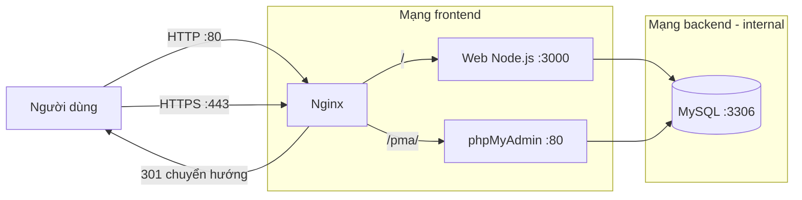

# Hệ thống Quản lý Sinh viên

Ứng dụng web CRUD quản lý **lớp học, sinh viên và điểm số**, triển khai hoàn toàn bằng **Docker Compose**:
Node.js/Express + MySQL + phpMyAdmin, đặt sau **Nginx reverse proxy** với HTTPS tự ký và security headers.

> Bài thi thực hành cuối kỳ môn *Triển khai và Quản trị Hệ thống Phần mềm*.
> Sinh viên: Trần Trung Hiếu — MSSV DTC245230003.

## 1. Kiến trúc



- **Nginx** là cổng vào duy nhất, chỉ publish cổng **80** và **443**. Web và phpMyAdmin không mở cổng ra ngoài.
- **backend** là mạng `internal: true`: container trong mạng này không có đường ra internet.
- Dữ liệu MySQL lưu trong volume `mysql_data`, không mất khi dựng lại container.

## 2. Yêu cầu

- Docker Engine + Docker Compose v2 (`docker compose`)
- `openssl` (sinh chứng chỉ), `setfacl` (cấp quyền đọc khóa cho container)
- RAM tối thiểu ~2 GB, ổ đĩa trống tối thiểu ~3 GB

## 3. Cài đặt

```bash
git clone <URL_REPO> student-management
cd student-management
```

### 3.1. Tạo tệp môi trường

```bash
cp .env.example .env
chmod 600 .env
```

Mở `.env` và thay ba giá trị mật khẩu bằng chuỗi ngẫu nhiên mạnh:

```bash
openssl rand -hex 16    # chạy 3 lần, mỗi lần lấy một giá trị
```

| Biến | Ý nghĩa |
|---|---|
| `MYSQL_ROOT_PASSWORD` | Mật khẩu `root` của MySQL (chỉ dùng quản trị) |
| `DB_NAME` | Tên database (mặc định `studentdb`) |
| `DB_USER` | Tài khoản ứng dụng dùng kết nối DB |
| `DB_PASSWORD` | Mật khẩu của tài khoản ứng dụng |

### 3.2. Sinh chứng chỉ TLS tự ký

```bash
./scripts/gen-cert.sh 192.168.44.131 student.local
```

- SAN gồm IP máy chủ, `student.local`, `localhost`, `127.0.0.1`.
- Nếu IP máy thay đổi, chạy lại với `FORCE_REGEN=1 ./scripts/gen-cert.sh <IP> student.local`.
- Khóa riêng `nginx/certs/server.key` đã nằm trong `.gitignore`; script cấp quyền đọc cho user 101 của container Nginx bằng ACL.

### 3.3. Khởi động

```bash
docker compose up -d --build
docker compose ps
```

Lần đầu MySQL khởi tạo dữ liệu mẫu có thể mất vài phút trên máy chậm.
Healthcheck của `db` đã đặt `start_period: 120s` và `retries: 30` để tránh báo lỗi sai.

## 4. Truy cập

| Mục | URL |
|---|---|
| Website | `https://192.168.44.131/` hoặc `https://student.local/` |
| phpMyAdmin | `https://192.168.44.131/pma/` |
| HTTP (tự chuyển hướng) | `http://192.168.44.131/` → 301 sang HTTPS |

Chứng chỉ tự ký nên trình duyệt cảnh báo: chọn **Advanced → Proceed**.

Muốn dùng `student.local`, thêm dòng sau vào `C:\Windows\System32\drivers\etc\hosts` (cần Administrator):

```
192.168.44.131 student.local
```

## 5. Dữ liệu mẫu

| Bảng | Số bản ghi | Ghi chú |
|---|---|---|
| `classes` | 3 | CNTT01, CNTT02, KTPM01 |
| `students` | 8 | SV001–SV008 |
| `grades` | 10 | ràng buộc điểm 0–10 |

Quan hệ: `students.class_id → classes.id` (ON DELETE RESTRICT), `grades.student_id → students.id` (ON DELETE CASCADE).

## 6. Kiểm tra nhanh

```bash
# Chuyển hướng HTTP sang HTTPS
curl -I http://192.168.44.131/

# Security headers
curl -kI https://192.168.44.131/

# TLS: chỉ chấp nhận 1.2 và 1.3
echo | openssl s_client -connect 192.168.44.131:443 -tls1_1

# Cổng 3000/8081 phải đóng
curl -m 3 http://192.168.44.131:3000/

# Trạng thái container
docker compose ps
```

Kết quả mong đợi: `301`, đủ 6 header bảo mật, TLS 1.1 bị từ chối, cổng 3000/8081 không kết nối được.

## 7. Bảo mật đã áp dụng

- Nginx là cổng vào duy nhất; web/phpMyAdmin không publish cổng.
- HTTPS bắt buộc, TLS 1.2/1.3, chứng chỉ SAN đúng IP và tên miền.
- Security headers: HSTS, CSP, X-Content-Type-Options, X-Frame-Options, Referrer-Policy, Permissions-Policy.
- `server_tokens off` (ẩn phiên bản Nginx); giới hạn `client_max_body_size 2m`.
- `/nginx-status` chỉ cho dải mạng nội bộ Docker, dùng cho exporter ở bước sau.
- Web chạy bằng user `node` (không phải root); tài khoản DB của ứng dụng chỉ có SELECT/INSERT/UPDATE/DELETE.
- Mật khẩu sinh bằng `openssl rand -hex 16`, lưu trong `.env` (đã gitignore, `chmod 600`).
- Mạng `backend` đặt `internal: true`.

## 8. Cấu trúc thư mục

```
.
├── app/                     # Ứng dụng Node.js (Express + EJS + mysql2)
│   ├── routes/              # classes, students, grades
│   ├── views/               # giao diện EJS
│   ├── public/              # style.css, app.js
│   └── Dockerfile
├── db/
│   ├── init.sql             # tạo bảng + dữ liệu mẫu
│   └── 02-create-app-user.sh# tạo user DB quyền tối thiểu
├── nginx/
│   ├── conf.d/default.conf  # reverse proxy, TLS, security headers
│   └── certs/               # chứng chỉ tự ký (KHÔNG commit)
├── scripts/
│   └── gen-cert.sh          # sinh chứng chỉ TLS
├── docs/screenshots/        # ảnh minh chứng
├── docker-compose.yml
├── .env.example
└── README.md
```

## 9. Xử lý sự cố

| Hiện tượng | Nguyên nhân / cách xử lý |
|---|---|
| `dependency failed to start: container sm-db is unhealthy` | Lần đầu khởi tạo DB chậm. Chờ thêm; healthcheck đã đặt `start_period: 120s`, `retries: 30`. |
| Nginx báo `Permission denied ... server.key` | Chạy lại `./scripts/gen-cert.sh` (script cấp ACL cho uid 101) hoặc kiểm tra `getfacl nginx/certs/server.key`. |
| Trình duyệt cảnh báo chứng chỉ | Bình thường với chứng chỉ tự ký: chọn Advanced → Proceed. |
| Không vào được `student.local` | Chưa thêm dòng vào file `hosts` của Windows. |
| Nginx báo `duplicate "log_format"` | Image Nginx đã có sẵn `log_format main`; cấu hình dùng tên riêng `sm_main`. |
| Cổng 80/443 bị chiếm | `sudo ss -tlnp | grep -E ':80|:443'` để tìm tiến trình đang dùng. |

## 10. Dừng và xóa

```bash
docker compose down          # dừng, GIỮ dữ liệu
docker compose down -v       # dừng và XÓA volume dữ liệu (mất toàn bộ dữ liệu)
```

> Chỉ dùng `down -v` khi thực sự muốn khởi tạo lại database từ đầu.

## 11. Ghi chú triển khai

- Image ghim phiên bản cụ thể (`mysql:8.0`, `phpmyadmin:5`, `nginxinc/nginx-unprivileged:1.27-alpine`) để tránh thay đổi ngoài ý muốn.
- Nginx dùng image **unprivileged** (user 101) nên lắng nghe 8080/8443 bên trong container và được ánh xạ ra 80/443.
- Cấu hình Nginx: `location` nào có `add_header` sẽ không kế thừa header của `server`, nên khối `/pma/` khai báo lại đầy đủ (kèm CSP nới lỏng cho phpMyAdmin).
