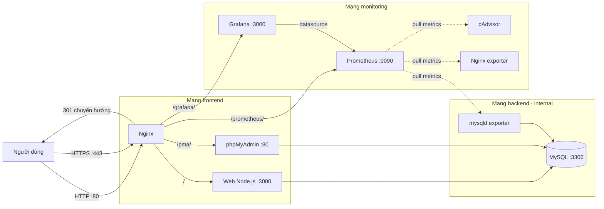

# Hệ thống Quản lý Sinh viên

Ứng dụng web CRUD quản lý **lớp học, sinh viên và điểm số**, triển khai hoàn toàn bằng **Docker Compose**:
Node.js/Express + MySQL + phpMyAdmin, đặt sau **Nginx reverse proxy** với HTTPS tự ký và security headers.
Hệ thống được giám sát bằng **Prometheus + Grafana** (số liệu container, web server, database).

> Bài thi thực hành cuối kỳ môn *Triển khai và Quản trị Hệ thống Phần mềm*.
> Sinh viên: Trần Trung Hiếu — MSSV DTC245230003.

## 1. Kiến trúc



- **Nginx** là cổng vào duy nhất, chỉ publish cổng **80** và **443**. Web, phpMyAdmin, Prometheus, Grafana không mở cổng ra ngoài.
- **backend** là mạng `internal: true`: container trong mạng này không có đường ra internet.
- **monitoring** chứa Prometheus, Grafana và các exporter. Prometheus kéo (pull) số liệu mỗi 15 giây.
- Dữ liệu MySQL lưu trong volume `mysql_data`, không mất khi dựng lại container.

## 2. Yêu cầu

- Docker Engine + Docker Compose v2 (`docker compose`)
- `openssl` (sinh chứng chỉ), `setfacl` (cấp quyền đọc khóa cho container)
- RAM tối thiểu ~3 GB (đã chạy thử với 3.8 GB), ổ đĩa trống tối thiểu ~3 GB

## 3. Cài đặt

```bash
git clone <URL_REPO> student-management
cd student-management
```

### 3.1. Tạo tệp môi trường

```bash
cp .env.example .env
chmod 600 .env
```

Mở `.env` và điền các giá trị. Sinh mật khẩu ngẫu nhiên mạnh cho từng tài khoản:

```bash
openssl rand -hex 16    # chạy 4 lần, mỗi lần lấy một giá trị
```

| Biến | Ý nghĩa |
|---|---|
| `MYSQL_ROOT_PASSWORD` | Mật khẩu `root` của MySQL (chỉ dùng quản trị) |
| `DB_NAME` | Tên database (mặc định `studentdb`) |
| `DB_USER` | Tài khoản ứng dụng dùng kết nối DB |
| `DB_PASSWORD` | Mật khẩu của tài khoản ứng dụng |
| `SERVER_IP` | IP máy chủ, dùng để dựng URL cho Prometheus/Grafana |
| `GRAFANA_ADMIN_USER` | Tài khoản quản trị Grafana |
| `GRAFANA_ADMIN_PASSWORD` | Mật khẩu quản trị Grafana (mạnh, không dùng mặc định) |
| `EXPORTER_DB_USER` | Tài khoản DB riêng cho mysqld-exporter |
| `EXPORTER_DB_PASSWORD` | Mật khẩu của tài khoản exporter |

Tạo tệp cấu hình cho mysqld-exporter (chứa mật khẩu, đã gitignore, `chmod 600`):

```bash
./scripts/gen-exporter-config.sh
```

### 3.2. Sinh chứng chỉ TLS tự ký

```bash
./scripts/gen-cert.sh 192.168.44.131 student.local
```

- SAN gồm IP máy chủ, `student.local`, `localhost`, `127.0.0.1`.
- Nếu IP máy thay đổi, chạy lại với `FORCE_REGEN=1 ./scripts/gen-cert.sh <IP> student.local`.
- Khóa riêng `nginx/certs/server.key` đã nằm trong `.gitignore`; script cấp quyền đọc cho user 101 của container Nginx bằng ACL.

### 3.3. Khởi động

```bash
docker compose up -d --build
docker compose ps
```

Lần đầu MySQL khởi tạo dữ liệu mẫu có thể mất vài phút trên máy chậm.
Healthcheck của `db` đã đặt `start_period: 120s` và `retries: 30` để tránh báo lỗi sai.
Lần đầu cần tải khoảng 3.6 GB image (MySQL, phpMyAdmin, Grafana, Prometheus...), nên chạy khi ổ còn đủ trống.

## 4. Truy cập

| Mục | URL |
|---|---|
| Website | `https://192.168.44.131/` hoặc `https://student.local/` |
| phpMyAdmin | `https://192.168.44.131/pma/` |
| Grafana | `https://192.168.44.131/grafana/` (đăng nhập bằng tài khoản trong `.env`) |
| Prometheus | `https://192.168.44.131/prometheus/` |
| HTTP (tự chuyển hướng) | `http://192.168.44.131/` → 301 sang HTTPS |

Chứng chỉ tự ký nên trình duyệt cảnh báo: chọn **Advanced → Proceed**.

Muốn dùng `student.local`, thêm dòng sau vào `C:\Windows\System32\drivers\etc\hosts` (cần Administrator):

```
192.168.44.131 student.local
```

## 5. Dữ liệu mẫu

| Bảng | Số bản ghi | Ghi chú |
|---|---|---|
| `classes` | 3 | CNTT01, CNTT02, KTPM01 |
| `students` | 8 | SV001–SV008 |
| `grades` | 10 | ràng buộc điểm 0–10 |

Quan hệ: `students.class_id → classes.id` (ON DELETE RESTRICT), `grades.student_id → students.id` (ON DELETE CASCADE).

## 6. Kiểm tra nhanh

```bash
# Chuyển hướng HTTP sang HTTPS
curl -I http://192.168.44.131/

# Security headers
curl -kI https://192.168.44.131/

# TLS: chỉ chấp nhận 1.2 và 1.3
echo | openssl s_client -connect 192.168.44.131:443 -tls1_1

# Cổng 3000/8081 phải đóng
curl -m 3 http://192.168.44.131:3000/

# Trạng thái container
docker compose ps

# 4 target Prometheus phải đều "up"
curl -sk https://192.168.44.131/prometheus/api/v1/targets | grep -o '"health":"up"' | wc -l

# Grafana trả trang đăng nhập
curl -sk -o /dev/null -w '%{http_code}\n' https://192.168.44.131/grafana/login
```

Kết quả mong đợi: `301`, đủ 6 header bảo mật, TLS 1.1 bị từ chối, cổng 3000/8081 không kết nối được, 4 target `up`, Grafana trả `200`.

## 7. Giám sát (Prometheus + Grafana)

### 7.1. Thành phần

| Dịch vụ | Image (ghim phiên bản) | Vai trò | Mạng |
|---|---|---|---|
| `prometheus` | `prom/prometheus:v2.55.1` | Kéo số liệu mỗi 15 giây, lưu 7 ngày / tối đa 250 MB | `monitoring` |
| `grafana` | `grafana/grafana:11.6.0` | Hiển thị dashboard, truy cập qua `/grafana/` | `monitoring` |
| `cadvisor` | `gcr.io/cadvisor/cadvisor:v0.54.1` | CPU, RAM, mạng của từng container | `monitoring` |
| `nginx-exporter` | `nginx/nginx-prometheus-exporter:1.3.0` | Đọc `stub_status` của Nginx (kết nối, request) | `frontend`, `monitoring` |
| `mysqld-exporter` | `prom/mysqld-exporter:v0.15.1` | Số liệu MySQL qua user DB quyền tối thiểu | `backend`, `monitoring` |

Không dịch vụ giám sát nào publish cổng ra ngoài. Prometheus và Grafana chỉ truy cập được qua Nginx (HTTPS).

### 7.2. Cơ chế hoạt động

- **Prometheus pull** (kéo) số liệu từ các endpoint `/metrics` theo chu kỳ 15 giây. Cấu hình ở `monitoring/prometheus.yml`.
- **cAdvisor** đọc cgroup và Docker API. Lưu ý: Docker 29 dùng *containerd image store*, nên phải dùng cAdvisor **≥ v0.54.0** và mount thêm `/run/containerd/containerd.sock` (chỉ đọc); bản cũ hơn chỉ thấy cgroup gốc.
- **nginx-exporter** đọc `http://nginx:8080/nginx-status`. Location này chỉ cho dải mạng nội bộ Docker, người ngoài nhận `403`.
- **mysqld-exporter** dùng tài khoản `EXPORTER_DB_USER` (quyền `PROCESS`, `REPLICATION CLIENT`, `SELECT` trên đúng database, tối đa 3 kết nối), cấu hình đọc từ `monitoring/.my.cnf` — tệp này sinh bằng `scripts/gen-exporter-config.sh`, đã gitignore và `chmod 600`.
- **Grafana** tự nạp datasource Prometheus và dashboard từ `monitoring/grafana/` (provisioning bằng tệp, không cấu hình tay).

### 7.3. Dashboard

Dashboard **“Quản lý sinh viên - Tổng quan hệ thống”** (uid `sinh-vien-tong-quan`) gồm 3 nhóm:

| Nhóm | Panel | PromQL chính |
|---|---|---|
| Container | CPU, RAM, mạng theo container | `sum by (name) (rate(container_cpu_usage_seconds_total{name=~"sm-.+"}[5m]))`, `container_memory_working_set_bytes`, `container_network_*_bytes_total` |
| Web server | Nginx UP, kết nối, request/giây | `nginx_up`, `nginx_connections_*`, `rate(nginx_http_requests_total[5m])` |
| Database | MySQL UP, luồng kết nối, truy vấn/giây, max connections | `mysql_up`, `mysql_global_status_threads_*`, `rate(mysql_global_status_queries[5m])`, `mysql_global_variables_max_connections` |

Mọi PromQL đã được kiểm chứng bằng API Prometheus trước khi đưa vào dashboard (không có panel “No data”).

### 7.4. Kiểm tra

```bash
# 4 target: cadvisor, mysql, nginx, prometheus — tất cả "up"
curl -sk https://192.168.44.131/prometheus/api/v1/targets

# Truy vấn thử mysql_up (kết quả 1)
curl -skG https://192.168.44.131/prometheus/api/v1/query \
  --data-urlencode 'query=mysql_up'

# Trạng thái dịch vụ
docker compose ps
docker compose logs --tail=50 cadvisor grafana prometheus
```

## 8. Bảo mật đã áp dụng

- Nginx là cổng vào duy nhất; web/phpMyAdmin không publish cổng.
- HTTPS bắt buộc, TLS 1.2/1.3, chứng chỉ SAN đúng IP và tên miền.
- Security headers: HSTS, CSP, X-Content-Type-Options, X-Frame-Options, Referrer-Policy, Permissions-Policy.
- `server_tokens off` (ẩn phiên bản Nginx); giới hạn `client_max_body_size 2m`.
- `/nginx-status` chỉ cho dải mạng nội bộ Docker, dùng cho exporter ở bước sau.
- Web chạy bằng user `node` (không phải root); tài khoản DB của ứng dụng chỉ có SELECT/INSERT/UPDATE/DELETE.
- Mật khẩu sinh bằng `openssl rand -hex 16`, lưu trong `.env` (đã gitignore, `chmod 600`).
- Mạng `backend` đặt `internal: true`.
- Grafana: tắt đăng ký tài khoản và truy cập ẩn danh; mật khẩu admin mạnh lấy từ `.env`; không publish cổng 3000.
- Prometheus và các exporter chỉ nằm trong mạng `monitoring`, không publish cổng; truy cập qua Nginx.
- `mysqld-exporter` dùng tài khoản DB riêng, quyền tối thiểu và `MAX_USER_CONNECTIONS 3`; tệp `.my.cnf` có mật khẩu nằm trong `.gitignore`, `chmod 600` và cấp ACL chỉ cho uid 65534 của exporter đọc.
- cAdvisor và promtail (giai đoạn sau) cần đọc socket Docker/containerd nên chạy quyền cao; đây là rủi ro đã biết, được ghi rõ trong báo cáo.

## 9. Cấu trúc thư mục

```
.
├── app/                     # Ứng dụng Node.js (Express + EJS + mysql2)
│   ├── routes/              # classes, students, grades
│   ├── views/               # giao diện EJS
│   ├── public/              # style.css, app.js
│   └── Dockerfile
├── db/
│   ├── init.sql             # tạo bảng + dữ liệu mẫu
│   ├── 02-create-app-user.sh    # tạo user DB quyền tối thiểu cho app
│   └── 03-create-exporter-user.sh # tạo user DB cho mysqld-exporter
├── monitoring/
│   ├── prometheus.yml       # cấu hình scrape 4 target
│   ├── .my.cnf              # mật khẩu exporter (sinh tự động, KHÔNG commit)
│   └── grafana/
│       ├── provisioning/    # datasource + provider dashboard
│       └── dashboards/      # dashboard JSON nạp tự động
├── nginx/
│   ├── conf.d/default.conf  # reverse proxy, TLS, security headers
│   └── certs/               # chứng chỉ tự ký (KHÔNG commit)
├── scripts/
│   ├── gen-cert.sh          # sinh chứng chỉ TLS
│   └── gen-exporter-config.sh # sinh monitoring/.my.cnf từ .env
├── docs/screenshots/        # ảnh minh chứng
├── docker-compose.yml
├── .env.example
└── README.md
```

## 10. Xử lý sự cố

| Hiện tượng | Nguyên nhân / cách xử lý |
|---|---|
| `dependency failed to start: container sm-db is unhealthy` | Lần đầu khởi tạo DB chậm. Chờ thêm; healthcheck đã đặt `start_period: 120s`, `retries: 30`. |
| Nginx báo `Permission denied ... server.key` | Chạy lại `./scripts/gen-cert.sh` (script cấp ACL cho uid 101) hoặc kiểm tra `getfacl nginx/certs/server.key`. |
| Trình duyệt cảnh báo chứng chỉ | Bình thường với chứng chỉ tự ký: chọn Advanced → Proceed. |
| Không vào được `student.local` | Chưa thêm dòng vào file `hosts` của Windows. |
| Nginx báo `duplicate "log_format"` | Image Nginx đã có sẵn `log_format main`; cấu hình dùng tên riêng `sm_main`. |
| Cổng 80/443 bị chiếm | `sudo ss -tlnp | grep -E ':80|:443'` để tìm tiến trình đang dùng. |
| cAdvisor chỉ có 1 series `id="/"`, log báo `failed to identify the read-write layer ID` | Docker 29 dùng containerd image store. Dùng cAdvisor ≥ v0.54.1 và mount `/run/containerd/containerd.sock:ro` (đã cấu hình sẵn). |
| Target `prometheus` DOWN, lỗi 404 | Prometheus chạy với `--web.route-prefix=/prometheus/`, nên `metrics_path` phải là `/prometheus/metrics` (đã cấu hình). |
| Log Grafana có `database is locked` lúc khởi động | SQLite của Grafana tự thử lại, không ảnh hưởng; chờ vài giây rồi tải lại trang. |
| Dashboard không xuất hiện | Kiểm tra `docker compose logs grafana`, quyền đọc thư mục `monitoring/grafana/dashboards`, và chờ tối đa 30 giây (provider quét lại). |
| Grafana hiện “No data” dù Prometheus có dữ liệu | Prometheus chạy với `--web.route-prefix=/prometheus/`, nên URL datasource phải là `http://prometheus:9090/prometheus` (thiếu `/prometheus` sẽ 404). Sửa `monitoring/grafana/provisioning/datasources/datasources.yml` rồi `docker compose restart grafana`. |
| mysqld-exporter báo `Access denied` | Chạy lại `./scripts/gen-exporter-config.sh` và `docker compose restart mysqld-exporter`; kiểm tra user exporter trong DB. |
| Grafana/Prometheus trả `502` sau khi restart hai container này | Nginx phân giải DNS lúc khởi động nên vẫn trỏ IP cũ. Chạy `docker compose restart nginx`. |

## 11. Dừng và xóa

```bash
docker compose down          # dừng, GIỮ dữ liệu
docker compose down -v       # dừng và XÓA volume dữ liệu (mất toàn bộ dữ liệu)
```

> Chỉ dùng `down -v` khi thực sự muốn khởi tạo lại database từ đầu.

## 12. Ghi chú triển khai

- Image ghim phiên bản cụ thể (`mysql:8.0`, `phpmyadmin:5`, `nginxinc/nginx-unprivileged:1.27-alpine`, `prom/prometheus:v2.55.1`, `grafana/grafana:11.6.0`, `gcr.io/cadvisor/cadvisor:v0.54.1`) để tránh thay đổi ngoài ý muốn.
- cAdvisor phải dùng v0.54.1 vì Docker 29 chuyển sang containerd image store; bản cũ hơn không đọc được container nào.
- Nginx dùng image **unprivileged** (user 101) nên lắng nghe 8080/8443 bên trong container và được ánh xạ ra 80/443.
- Cấu hình Nginx: `location` nào có `add_header` sẽ không kế thừa header của `server`, nên khối `/pma/` khai báo lại đầy đủ (kèm CSP nới lỏng cho phpMyAdmin).
